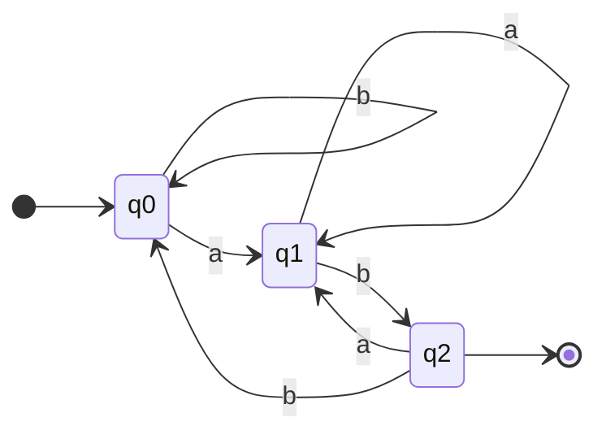
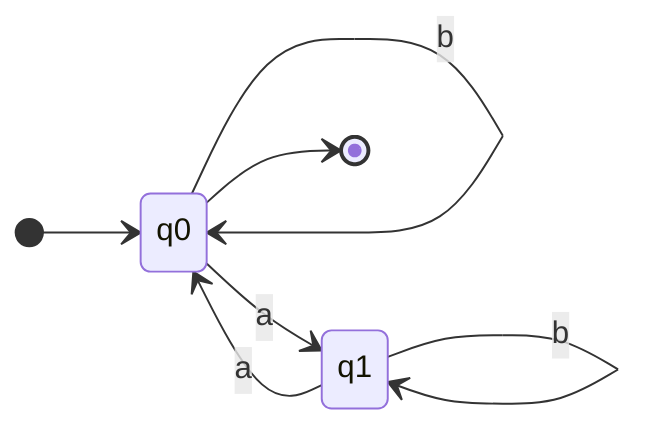
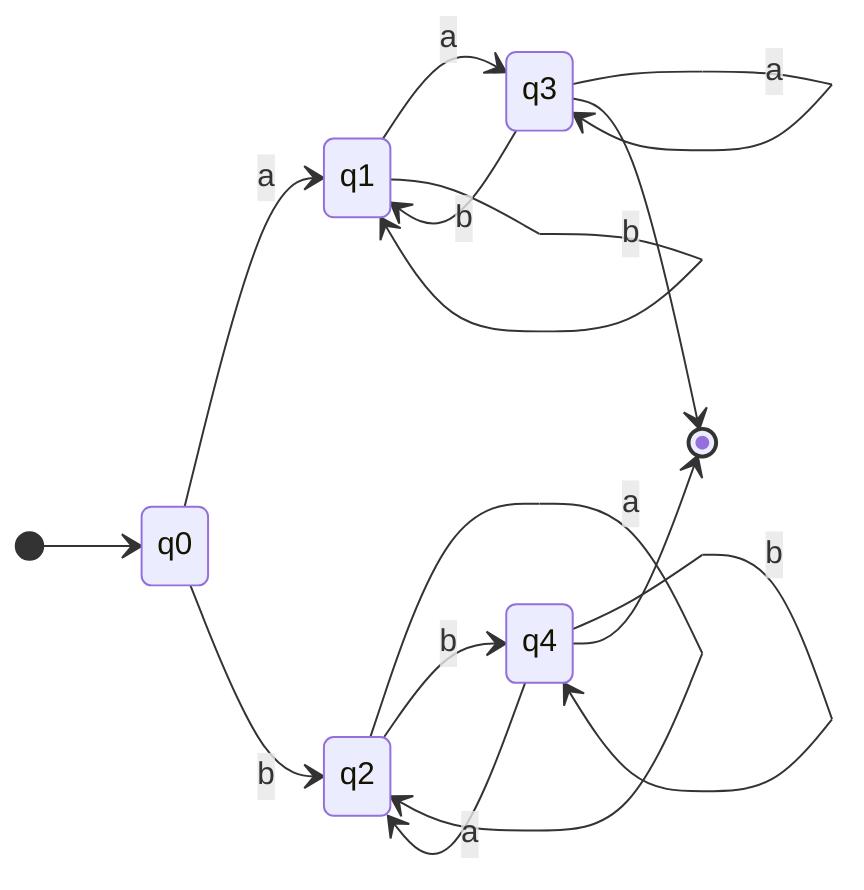
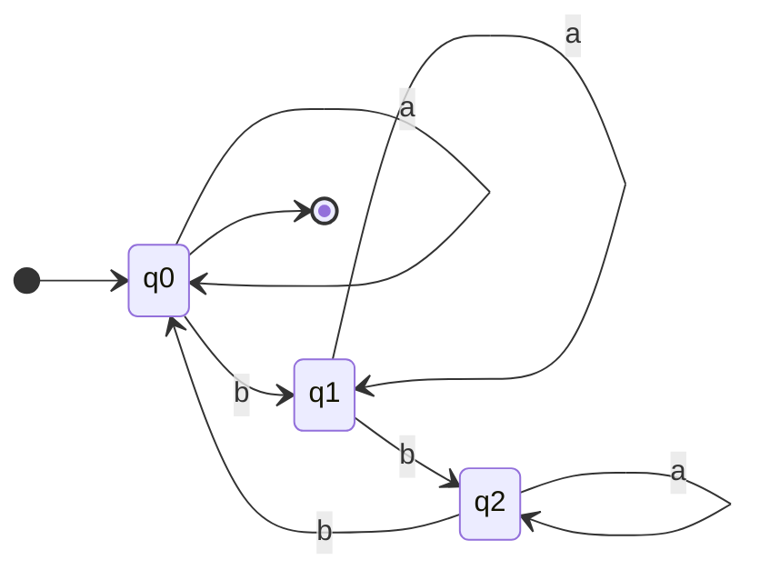
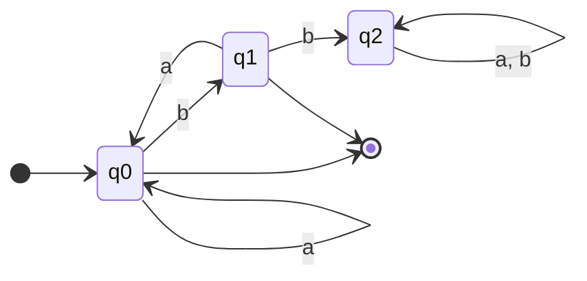

# Práctica N° 1 – Autómatas Finitos Deterministas (AFD)

**Tema general:** Teoría de Autómatas y Lenguajes Formales, con enfoque en los Autómatas Finitos Deterministas (AFD).

**Universidad de Panamá** · Facultad de Informática, Electrónica y Comunicación
Departamento de Computación y Sistemas · Teoría de Autómatas y Lenguajes Formales

En todos los problemas el alfabeto es **Σ = {a, b}**. Para cada uno se da:

1. La quíntupla **M = (Q, Σ, δ, q₀, F)**, con su tabla de transición y su diagrama.
2. La **expresión regular (ER)**.
3. El **lenguaje regular** en notación de conjuntos.

En las tablas, `→` marca el estado inicial y `*` los estados de aceptación. En las ER, `+` es la unión, `*` la clausura de Kleene y `ε` la cadena vacía. `|w|ₐ` es el número de símbolos `a` en la cadena `w`.

> Para ver la construcción guiada de cada grafo, abre el [visualizador interactivo](visualizador/index.html) en el navegador.

> Todas las soluciones se comprobaron con [`verificar_afd.py`](verificar_afd.py), que compara el AFD, la ER y la definición del conjunto sobre todas las cadenas de {a, b} de longitud ≤ 12.

---

## Problema 1 – Cadenas que terminan en "ab"

**Tema:** Reconocimiento de un sufijo específico ("ab").  
**Concepto:** Reconocimiento de patrones al final

### Quíntupla

M₁ = (Q, Σ, δ, q₀, F)

- Q = {q₀, q₁, q₂}
- Σ = {a, b}
- q₀ = q₀ (estado inicial)
- F = {q₂}

| δ       | a  | b  |
|---------|----|----|
| → q₀    | q₁ | q₀ |
| q₁      | q₁ | q₂ |
| \* q₂   | q₁ | q₀ |



**Significado de los estados:**
- q₀: la cadena leída no termina en `a` ni en `ab`.
- q₁: la cadena leída termina en `a` (falta una `b`).
- q₂: la cadena leída termina en `ab` → acepta.

### Expresión regular

**ER = (a + b)\* ab**

### Lenguaje

**L(M₁) = { w ∈ {a, b}\* | w = x·ab, x ∈ {a, b}\* }**

Ejemplos: aceptadas `ab`, `aab`, `bab`, `abab`; rechazadas `ε`, `a`, `ba`, `abb`.

---

## Problema 2 – Número par de símbolos "a"

**Tema:** Contar la paridad (par o impar) de un símbolo. Es un contador módulo 2 de las `a`; las `b` no cambian el estado.  
**Concepto:** Contador módulo 2

### Quíntupla

M₂ = (Q, Σ, δ, q₀, F)

- Q = {q₀, q₁}
- Σ = {a, b}
- q₀ = q₀
- F = {q₀}

| δ          | a  | b  |
|------------|----|----|
| → \* q₀    | q₁ | q₀ |
| q₁         | q₀ | q₁ |



**Significado de los estados:**
- q₀: se ha leído un número par de `a` → acepta (incluye 0 `a`, por eso ε ∈ L).
- q₁: se ha leído un número impar de `a`.

### Expresión regular

**ER = b\* (a b\* a b\*)\***

### Lenguaje

**L(M₂) = { w ∈ {a, b}\* | |w|ₐ ≡ 0 (mod 2) }** = { w ∈ {a, b}\* | |w|ₐ es par }

Ejemplos: aceptadas `ε`, `b`, `aa`, `abab`, `baab`; rechazadas `a`, `ab`, `aaa`.

---

## Problema 3 – Cadenas que empiezan y terminan con el mismo símbolo

**Tema:** Cadenas de al menos dos símbolos que comienzan y terminan con el mismo carácter.  
**Concepto:** Memoria del primer símbolo

> Según el grafo de la práctica, el primer y el último símbolo deben ser posiciones distintas: la cadena tiene **al menos dos símbolos**. Por eso `ε`, `a` y `b` se rechazan.

### Quíntupla

M₃ = (Q, Σ, δ, q₀, F)

- Q = {q₀, q₁, q₂, q₃, q₄}
- Σ = {a, b}
- q₀ = q₀
- F = {q₃, q₄}

| δ       | a  | b  |
|---------|----|----|
| → q₀    | q₁ | q₂ |
| q₁      | q₃ | q₁ |
| q₂      | q₂ | q₄ |
| \* q₃   | q₃ | q₁ |
| \* q₄   | q₂ | q₄ |



**Interpretación del grafo:** el autómata se divide en dos ramas según el primer símbolo leído (rama de `a`: q₁, q₃; rama de `b`: q₂, q₄) y solo acepta cuando el último símbolo coincide con el primero.
- q₀: no se ha leído nada.
- q₁: empezó con `a` y todavía no termina en otra `a` (se leyó solo la primera `a`, o el último símbolo es `b`).
- q₂: empezó con `b` y todavía no termina en otra `b`.
- q₃: empezó con `a` y termina en `a` → acepta.
- q₄: empezó con `b` y termina en `b` → acepta.

### Expresión regular

**ER = a(a + b)\*a + b(a + b)\*b**

### Lenguaje

**L(M₃) = { w ∈ {a, b}\* | |w| ≥ 2 y el primer símbolo de w es igual al último }** = { σxσ | σ ∈ {a, b}, x ∈ {a, b}\* }

Ejemplos: aceptadas `aa`, `bb`, `aba`, `bab`, `bbab`; rechazadas `ε`, `a`, `b`, `ab`, `abab`.

> Si se quisiera aceptar también `a` y `b` sueltas, la ER sería a + b + a(a + b)\*a + b(a + b)\*b y el autómata necesitaría otros estados.

---

## Problema 4 – Número de "b" múltiplo de 3

**Tema:** Contar un símbolo módulo 3 (residuos 0, 1 y 2). Es un contador cíclico de las `b`; las `a` no afectan el conteo.  
**Concepto:** Contador módulo 3

### Quíntupla

M₄ = (Q, Σ, δ, q₀, F)

- Q = {q₀, q₁, q₂}
- Σ = {a, b}
- q₀ = q₀
- F = {q₀}

| δ          | a  | b  |
|------------|----|----|
| → \* q₀    | q₀ | q₁ |
| q₁         | q₁ | q₂ |
| q₂         | q₂ | q₀ |



**Significado de los estados:** qᵢ indica que |w|_b mod 3 = i. Solo q₀ (resto 0) acepta; como 0 es múltiplo de 3, ε y las cadenas sin `b` pertenecen al lenguaje.

### Expresión regular

**ER = a\* (b a\* b a\* b a\*)\***

### Lenguaje

**L(M₄) = { w ∈ {a, b}\* | |w|_b ≡ 0 (mod 3) }**

Ejemplos: aceptadas `ε`, `aa`, `bbb`, `ababab`, `bbbbbb`; rechazadas `b`, `bb`, `abba`, `bbbb`.

---

## Problema 5 – Cadenas que no contienen la subcadena "bb"

**Tema:** Lenguajes que **evitan** un patrón prohibido (la subcadena "bb").  
**Concepto:** Estado trampa / rechazo irreversible

### Quíntupla

M₅ = (Q, Σ, δ, q₀, F)

- Q = {q₀, q₁, q₂}
- Σ = {a, b}
- q₀ = q₀
- F = {q₀, q₁}

| δ          | a  | b  |
|------------|----|----|
| → \* q₀    | q₀ | q₁ |
| \* q₁      | q₀ | q₂ |
| q₂         | q₂ | q₂ |



**Significado de los estados:**
- q₀: no se ha visto `bb` y el último símbolo no es `b` (o no se ha leído nada) → acepta.
- q₁: no se ha visto `bb` y el último símbolo es `b` → acepta.
- q₂: estado sumidero (trampa): ya apareció `bb`; ninguna continuación es aceptada.

### Expresión regular

**ER = (a + ba)\* (ε + b)**

Toda `b` que no sea el último símbolo debe ir seguida de una `a`.

### Lenguaje

**L(M₅) = { w ∈ {a, b}\* | bb no es subcadena de w }** = { w ∈ {a, b}\* | ¬∃ x, y ∈ {a, b}\* : w = x·bb·y }

Ejemplos: aceptadas `ε`, `b`, `ab`, `bab`, `abaab`; rechazadas `bb`, `abb`, `abba`, `babba`.

---

## Resumen de temas tratados

| # | Problema | Tema principal | Concepto de teoría de autómatas | \|Q\| | F | Expresión regular |
|---|----------|----------------|---------------------------------|-------|---|-------------------|
| 1 | Termina en `ab` | Sufijo específico | Reconocimiento de patrones al final | 3 | {q₂} | (a + b)\*ab |
| 2 | Número par de `a` | Paridad de un símbolo | Contador módulo 2 | 2 | {q₀} | b\*(ab\*ab\*)\* |
| 3 | Mismo símbolo al inicio y al final | Mismo símbolo al inicio y al final | Memoria del primer símbolo | 5 | {q₃, q₄} | a(a + b)\*a + b(a + b)\*b |
| 4 | Número de `b` múltiplo de 3 | Múltiplo de 3 de un símbolo | Contador módulo 3 | 3 | {q₀} | a\*(ba\*ba\*ba\*)\* |
| 5 | No contiene `bb` | Evitar una subcadena | Estado trampa / rechazo irreversible | 3 | {q₀, q₁} | (a + ba)\*(ε + b) |

## Cómo verificar

```bash
python3 practica1/verificar_afd.py
```

Salida esperada: `OK` en los 5 problemas.
