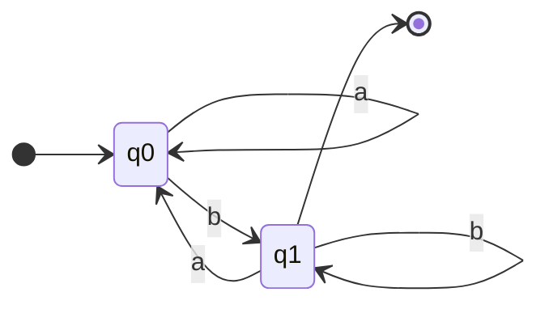
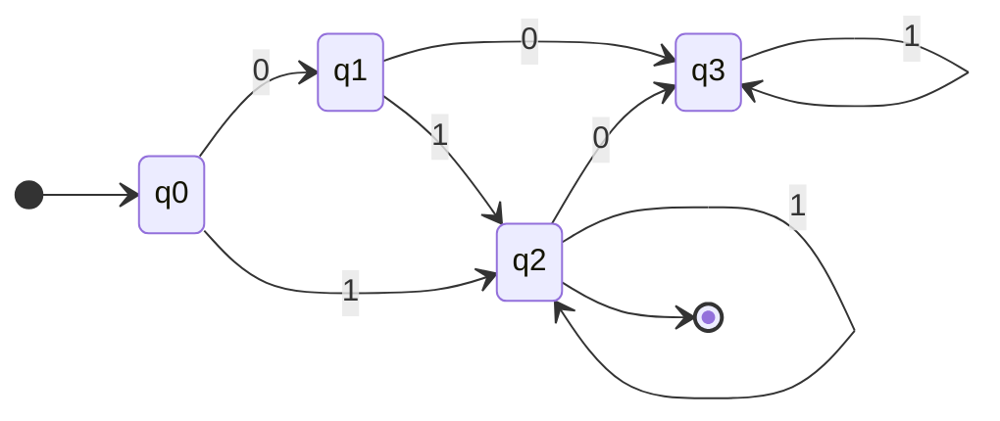
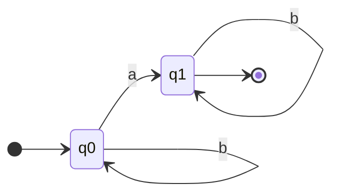
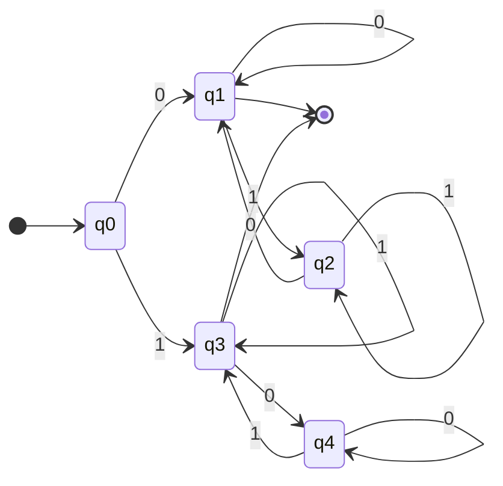
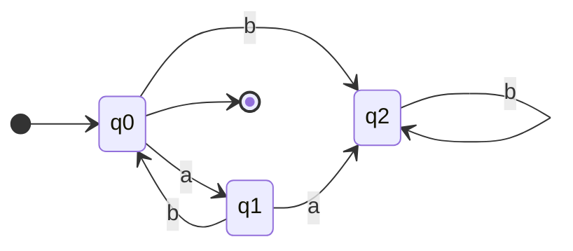
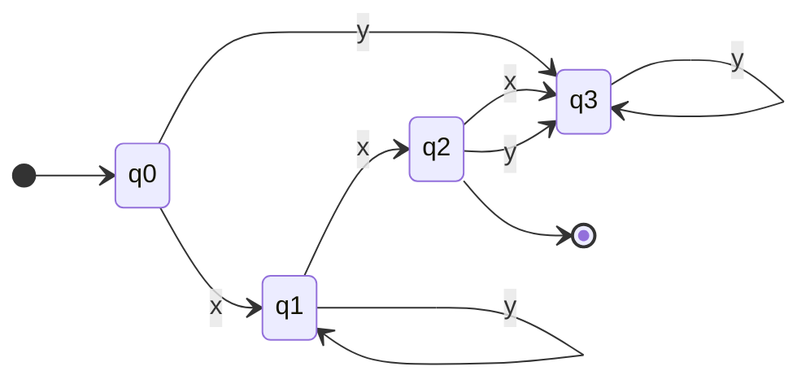
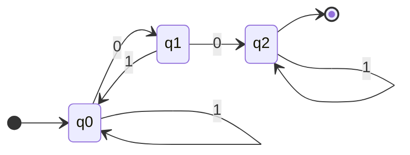
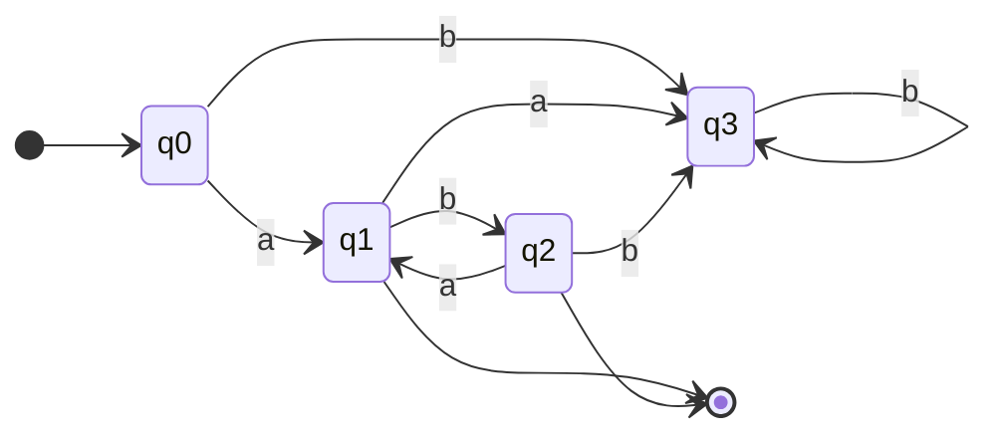
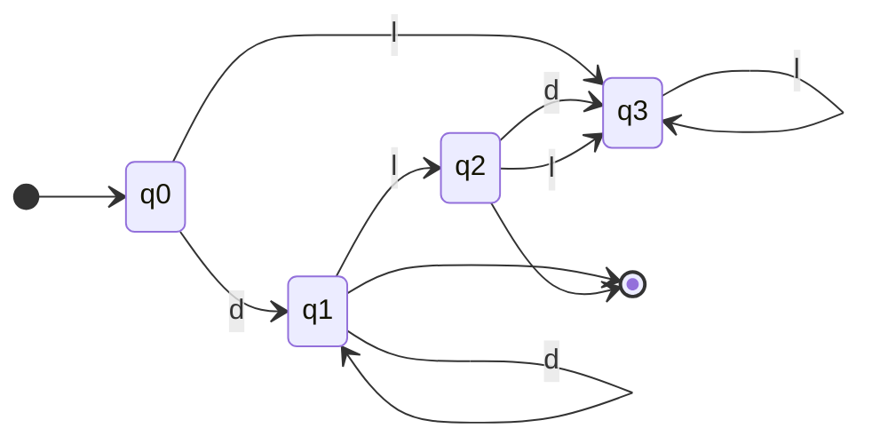
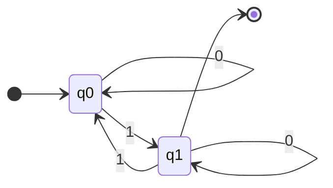

# Práctica de clase – Teoría de Autómatas y Lenguajes Formales (1-10-2026)

**Tema general:** Autómatas Finitos Deterministas (AFD). Para cada problema se pide:

1. Definir formalmente la quíntupla M = (Q, Σ, δ, q₀, F) del AFD.
2. Dibujar el diagrama de transición.
3. Elaborar la tabla de transición.
4. Obtener la expresión regular, usando correctamente los cuantificadores `*`, `+` y `?`.
5. Describir formalmente el lenguaje regular aceptado.

> **Notación de las ER:** `|` es la unión, `*` cero o más veces, `+` una o más veces y `?` opcional (cero o una vez). En las tablas, `→` marca el estado inicial y `*` los estados de aceptación.

> Para ver cada grafo construirse paso a paso, abre el [visualizador interactivo](../practica1/visualizador/index.html) y elige **Práctica de clase**. Todas las soluciones se comprobaron con [`verificar_afd.py`](verificar_afd.py).

## Resumen

| # | Problema | Σ | Concepto | ER |
|---|----------|---|----------|----|
| 1 | Cadenas que terminan con la letra “b” | {a, b} | Reconocimiento del último símbolo | `(a|b)*b` |
| 2 | Presencia opcional del prefijo “0” | {0, 1} | Cuantificadores ? y + | `0?1+` |
| 3 | Cadenas con al menos una “a” | {a, b} | Estado de aceptación absorbente | `b*a(a|b)*` |
| 4 | Cadenas que comienzan y terminan con la misma letra | {0, 1} | Memoria del primer símbolo | `0((0|1)*0)?|1((0|1)*1)?` |
| 5 | Cero o más bloques repetidos de “ab” | {a, b} | Ciclo que vuelve al estado inicial | `(ab)*` |
| 6 | Secuencia con repetición opcional intermedia | {x, y} | Bucle intermedio opcional | `x(y+)?x` |
| 7 | Cadenas que contienen dos ceros consecutivos | {0, 1} | Búsqueda de patrón con estado absorbente | `(0|1)*00(0|1)*` |
| 8 | Cadenas alternas de longitud arbitraria | {a, b} | Estados que alternan y estado trampa | `a(ba)*b?` |
| 9 | Identificador numérico con sufijo opcional de letra | {d, l} | Cuantificadores + y ? | `d+l?` |
| 10 | Cadenas con número impar de “1” | {0, 1} | Contador módulo 2 | `0*1(0*10*1)*0*` |

---

## Problema 1 – Cadenas que terminan con la letra “b”

**Tema:** Cadenas que terminan con una letra específica.  
**Concepto:** Reconocimiento del último símbolo

Diseñar un AFD que acepte todas las cadenas sobre {a, b} que terminan exactamente con la letra b. Aceptadas: b, ab, aab, bb. Rechazadas: a, ba, ε.

### 1. Quíntupla

M₁ = (Q, Σ, δ, q₀, F)

- Q = {q₀, q₁}
- Σ = {a, b}
- q₀ = q₀ (estado inicial)
- F = {q₁}

### 2. Diagrama de transición

**Interpretación de los estados:**
- q₀: La cadena leída no termina en b: está vacía o su último símbolo es a.
- q₁ (aceptación): La cadena leída termina en b.

### 3. Tabla de transición

| δ | a | b |
|---|---|---|
| → q₀ | q₀ | q₁ |
| \* q₁ | q₀ | q₁ |

### 4. Expresión regular

1. Antes de la b final puede venir cualquier cantidad de a y b, incluso ninguna: (a|b)\*. El cuantificador \* representa esas repeticiones previas.
2. Después viene obligatoriamente una b.
3. Concatenando: (a|b)\*b.

**ER = `(a|b)*b`**

### 5. Lenguaje

**L(M₁) = { w ∈ {a, b}\* | w = xb, x ∈ {a, b}\* }**

Todas las cadenas cuyo último símbolo es b.

---

## Problema 2 – Presencia opcional del prefijo “0”

**Tema:** Un prefijo opcional seguido de una repetición obligatoria.  
**Concepto:** Cuantificadores ? y +

Diseñar un AFD que acepte cadenas que comienzan opcionalmente con un 0, seguido obligatoriamente de uno o más 1. Aceptadas: 1, 01, 11, 0111. Rechazadas: 0, ε, 10.

### 1. Quíntupla

M₂ = (Q, Σ, δ, q₀, F)

- Q = {q₀, q₁, q₂, q₃}
- Σ = {0, 1}
- q₀ = q₀ (estado inicial)
- F = {q₂}

### 2. Diagrama de transición

**Interpretación de los estados:**
- q₀: No se ha leído nada.
- q₁: Se leyó el 0 opcional; falta al menos un 1.
- q₂ (aceptación): Ya se leyó al menos un 1 (con o sin el 0 al inicio).
- q₃ (trampa): Estado trampa: apareció un 0 donde no se permite (un segundo 0, o un 0 después de los 1).

### 3. Tabla de transición

| δ | 0 | 1 |
|---|---|---|
| → q₀ | q₁ | q₂ |
| q₁ | q₃ | q₂ |
| \* q₂ | q₃ | q₂ |
| q₃ | q₃ | q₃ |

### 4. Expresión regular

1. El 0 del inicio es opcional: 0?.
2. Después vienen uno o más 1: 1+.
3. Concatenando: 0?1+.

**ER = `0?1+`**

### 5. Lenguaje

**L(M₂) = { 0ⁱ1ⁿ | i ∈ {0, 1}, n ≥ 1 }**

Cero o un 0 al inicio, seguido de al menos un 1, y nada más.

---

## Problema 3 – Cadenas con al menos una “a”

**Tema:** Exigir que un símbolo aparezca al menos una vez.  
**Concepto:** Estado de aceptación absorbente

Diseñar un AFD que reconozca las cadenas que contienen al menos una a. Aceptadas: a, ba, aba, bbbbab. Rechazadas: b, bb, ε.

### 1. Quíntupla

M₃ = (Q, Σ, δ, q₀, F)

- Q = {q₀, q₁}
- Σ = {a, b}
- q₀ = q₀ (estado inicial)
- F = {q₁}

### 2. Diagrama de transición

**Interpretación de los estados:**
- q₀: Todavía no aparece ninguna a (solo b, o nada).
- q₁ (aceptación): Ya apareció al menos una a. Lo que venga después no cambia eso.

### 3. Tabla de transición

| δ | a | b |
|---|---|---|
| → q₀ | q₁ | q₀ |
| \* q₁ | q₁ | q₁ |

### 4. Expresión regular

1. Antes de la primera a solo puede haber b: b\*.
2. Luego la primera a.
3. Después, cualquier cosa: (a|b)\*.
4. Concatenando: b\*a(a|b)\*.

**ER = `b*a(a|b)*`**

### 5. Lenguaje

**L(M₃) = { w ∈ {a, b}\* | |w|ₐ ≥ 1 }**

|w|ₐ es la cantidad de a en w. Equivale a w = xay, con x, y ∈ {a, b}\*.

---

## Problema 4 – Cadenas que comienzan y terminan con la misma letra

**Tema:** Cadenas de longitud ≥ 1 con el mismo primer y último símbolo.  
**Concepto:** Memoria del primer símbolo

Diseñar un AFD para cadenas de longitud ≥ 1 que comienzan y terminan con el mismo símbolo (0…0, 1…1, o un solo dígito). Aceptadas: 0, 1, 00, 101, 11101. Rechazadas: 01, 10.

### 1. Quíntupla

M₄ = (Q, Σ, δ, q₀, F)

- Q = {q₀, q₁, q₂, q₃, q₄}
- Σ = {0, 1}
- q₀ = q₀ (estado inicial)
- F = {q₁, q₃}

### 2. Diagrama de transición

**Interpretación de los estados:**
- q₀: No se ha leído nada. No acepta, porque ε tiene longitud 0.
- q₁ (aceptación): Empezó con 0 y el último símbolo es 0.
- q₂: Empezó con 0 y el último símbolo es 1.
- q₃ (aceptación): Empezó con 1 y el último símbolo es 1.
- q₄: Empezó con 1 y el último símbolo es 0.

### 3. Tabla de transición

| δ | 0 | 1 |
|---|---|---|
| → q₀ | q₁ | q₃ |
| \* q₁ | q₁ | q₂ |
| q₂ | q₁ | q₂ |
| \* q₃ | q₄ | q₃ |
| q₄ | q₄ | q₃ |

### 4. Expresión regular

1. Rama del 0: un 0 solo, o 0, cualquier cosa y 0 al final: 0((0|1)\*0)?.
2. Rama del 1: 1((0|1)\*1)?.
3. El ? hace opcional todo lo que sigue al primer símbolo; así se aceptan 0 y 1 solos.
4. Unimos las dos ramas con |.

**ER = `0((0|1)*0)?|1((0|1)*1)?`**

### 5. Lenguaje

**L(M₄) = { w ∈ {0, 1}⁺ | el primer símbolo de w es igual al último }**

{0, 1}⁺ son las cadenas de longitud ≥ 1. Equivale a w = σ o w = σxσ, con σ ∈ {0, 1} y x ∈ {0, 1}\*.

---

## Problema 5 – Cero o más bloques repetidos de “ab”

**Tema:** Repetición consecutiva de una secuencia fija.  
**Concepto:** Ciclo que vuelve al estado inicial

Diseñar un AFD que acepte la cadena vacía y cualquier repetición consecutiva de "ab": ab, abab, ababab, …

### 1. Quíntupla

M₅ = (Q, Σ, δ, q₀, F)

- Q = {q₀, q₁, q₂}
- Σ = {a, b}
- q₀ = q₀ (estado inicial)
- F = {q₀}

### 2. Diagrama de transición

**Interpretación de los estados:**
- q₀ (aceptación): Se han leído cero o más bloques "ab" completos. Es inicial y final, por eso ε se acepta.
- q₁: A mitad de un bloque: se leyó la a y falta la b.
- q₂ (trampa): Estado trampa: la cadena se salió del patrón (una b sin a antes, o dos a seguidas).

### 3. Tabla de transición

| δ | a | b |
|---|---|---|
| → \* q₀ | q₁ | q₂ |
| q₁ | q₂ | q₀ |
| q₂ | q₂ | q₂ |

### 4. Expresión regular

1. Cada vuelta al ciclo q₀ → q₁ → q₀ lee un bloque ab.
2. El ciclo se puede repetir cero o más veces: (ab)\*.

**ER = `(ab)*`**

### 5. Lenguaje

**L(M₅) = { (ab)ⁿ | n ≥ 0 }**

Con n = 0 se obtiene ε; con n = 1, ab; con n = 2, abab; y así sucesivamente.

---

## Problema 6 – Secuencia con repetición opcional intermedia

**Tema:** Una repetición opcional entre dos símbolos obligatorios.  
**Concepto:** Bucle intermedio opcional

Diseñar un AFD que acepte cadenas que inician con x, seguidas opcionalmente de una o más y, y que terminan obligatoriamente con x. Aceptadas: xx, xyx, xyyyx. Rechazadas: x, yx, xy.

### 1. Quíntupla

M₆ = (Q, Σ, δ, q₀, F)

- Q = {q₀, q₁, q₂, q₃}
- Σ = {x, y}
- q₀ = q₀ (estado inicial)
- F = {q₂}

### 2. Diagrama de transición

**Interpretación de los estados:**
- q₀: No se ha leído nada.
- q₁: Se leyó la x inicial; ahora pueden venir y, o la x final.
- q₂ (aceptación): Se leyó la x final: el patrón está completo.
- q₃ (trampa): Estado trampa: empezó con y, o vino algo después de la x final.

### 3. Tabla de transición

| δ | x | y |
|---|---|---|
| → q₀ | q₁ | q₃ |
| q₁ | q₂ | q₁ |
| \* q₂ | q₃ | q₃ |
| q₃ | q₃ | q₃ |

### 4. Expresión regular

1. Empieza con x.
2. Luego, opcionalmente, una o más y: (y+)?.
3. Termina con x.
4. Concatenando: x(y+)?x, que es equivalente a xy\*x.

**ER = `x(y+)?x`**

### 5. Lenguaje

**L(M₆) = { x yⁿ x | n ≥ 0 }**

Una x, cualquier cantidad de y (incluso ninguna) y una x final.

---

## Problema 7 – Cadenas que contienen dos ceros consecutivos

**Tema:** Detectar una subcadena en cualquier posición.  
**Concepto:** Búsqueda de patrón con estado absorbente

Diseñar un AFD que acepte cualquier cadena que contenga "00" en cualquier posición. Aceptadas: 00, 1001, 1100, 000. Rechazadas: 1, 1010, ε.

### 1. Quíntupla

M₇ = (Q, Σ, δ, q₀, F)

- Q = {q₀, q₁, q₂}
- Σ = {0, 1}
- q₀ = q₀ (estado inicial)
- F = {q₂}

### 2. Diagrama de transición

**Interpretación de los estados:**
- q₀: Aún no aparece "00" y el último símbolo no es 0 (o no se ha leído nada).
- q₁: Aún no aparece "00", pero el último símbolo es 0.
- q₂ (aceptación): Ya apareció "00". Lo que siga no cambia el resultado.

### 3. Tabla de transición

| δ | 0 | 1 |
|---|---|---|
| → q₀ | q₁ | q₀ |
| q₁ | q₂ | q₀ |
| \* q₂ | q₂ | q₂ |

### 4. Expresión regular

1. Antes de "00" puede haber cualquier cosa: (0|1)\*.
2. Luego el patrón: 00.
3. Después, cualquier cosa: (0|1)\*.
4. Concatenando: (0|1)\*00(0|1)\*.

**ER = `(0|1)*00(0|1)*`**

### 5. Lenguaje

**L(M₇) = { w ∈ {0, 1}\* | w = x00y, x, y ∈ {0, 1}\* }**

El título dice "exactamente dos ceros consecutivos", pero el enunciado pide que la cadena contenga "00" y acepta 000. Aquí se sigue el enunciado y sus ejemplos.

---

## Problema 8 – Cadenas alternas de longitud arbitraria

**Tema:** Alternancia estricta de dos símbolos, empezando con uno fijo.  
**Concepto:** Estados que alternan y estado trampa

Diseñar un AFD que acepte cadenas donde las letras se alternan estrictamente comenzando con a: a, ab, aba, abab, …

### 1. Quíntupla

M₈ = (Q, Σ, δ, q₀, F)

- Q = {q₀, q₁, q₂, q₃}
- Σ = {a, b}
- q₀ = q₀ (estado inicial)
- F = {q₁, q₂}

### 2. Diagrama de transición

**Interpretación de los estados:**
- q₀: No se ha leído nada. No acepta: la cadena debe empezar con a.
- q₁ (aceptación): La alternancia va bien y la última letra es a.
- q₂ (aceptación): La alternancia va bien y la última letra es b.
- q₃ (trampa): Estado trampa: empezó con b, o se repitió una letra (aa o bb).

### 3. Tabla de transición

| δ | a | b |
|---|---|---|
| → q₀ | q₁ | q₃ |
| \* q₁ | q₃ | q₂ |
| \* q₂ | q₁ | q₃ |
| q₃ | q₃ | q₃ |

### 4. Expresión regular

1. Empieza con a.
2. Luego cero o más pares "ba": (ba)\*.
3. Al final, opcionalmente, una b: b?.
4. Concatenando: a(ba)\*b?.

**ER = `a(ba)*b?`**

### 5. Lenguaje

**L(M₈) = { (ab)ⁿa | n ≥ 0 } ∪ { (ab)ⁿ | n ≥ 1 }**

Cadenas no vacías que empiezan con a y no contienen aa ni bb.

---

## Problema 9 – Identificador numérico con sufijo opcional de letra

**Tema:** Una o más repeticiones seguidas de un sufijo opcional.  
**Concepto:** Cuantificadores + y ?

Con Σ = {d, l} (d representa un dígito y l una letra), diseñar un AFD que acepte uno o más dígitos, seguidos opcionalmente de una letra. Aceptadas: d, dd, dl, dddl. Rechazadas: l, ld, ε.

### 1. Quíntupla

M₉ = (Q, Σ, δ, q₀, F)

- Q = {q₀, q₁, q₂, q₃}
- Σ = {d, l}
- q₀ = q₀ (estado inicial)
- F = {q₁, q₂}

### 2. Diagrama de transición

**Interpretación de los estados:**
- q₀: No se ha leído nada.
- q₁ (aceptación): Se han leído uno o más dígitos.
- q₂ (aceptación): Dígitos seguidos de la letra opcional: el identificador terminó.
- q₃ (trampa): Estado trampa: empezó con letra, o vino algo después de la letra.

### 3. Tabla de transición

| δ | d | l |
|---|---|---|
| → q₀ | q₁ | q₃ |
| \* q₁ | q₁ | q₂ |
| \* q₂ | q₃ | q₃ |
| q₃ | q₃ | q₃ |

### 4. Expresión regular

1. Uno o más dígitos: d+.
2. Opcionalmente una letra: l?.
3. Concatenando: d+l?.

**ER = `d+l?`**

### 5. Lenguaje

**L(M₉) = { dⁿlᵐ | n ≥ 1, m ∈ {0, 1} }**

Al menos un dígito y, como máximo, una letra al final.

---

## Problema 10 – Cadenas con número impar de “1”

**Tema:** Contar la paridad de un símbolo (impar).  
**Concepto:** Contador módulo 2

Diseñar un AFD que acepte las cadenas binarias con una cantidad impar de 1. Aceptadas: 1, 010, 111, 00100. Rechazadas: ε, 00, 11.

### 1. Quíntupla

M₁₀ = (Q, Σ, δ, q₀, F)

- Q = {q₀, q₁}
- Σ = {0, 1}
- q₀ = q₀ (estado inicial)
- F = {q₁}

### 2. Diagrama de transición

**Interpretación de los estados:**
- q₀: Cantidad par de 1 (al inicio hay 0, que es par).
- q₁ (aceptación): Cantidad impar de 1.

### 3. Tabla de transición

| δ | 0 | 1 |
|---|---|---|
| → q₀ | q₀ | q₁ |
| \* q₁ | q₁ | q₀ |

### 4. Expresión regular

1. Ceros iniciales y el primer 1: 0\*1.
2. Después, pares de 1 con ceros sueltos: (0\*10\*1)\*.
3. Ceros finales: 0\*.
4. Concatenando: 0\*1(0\*10\*1)\*0\*.

**ER = `0*1(0*10*1)*0*`**

### 5. Lenguaje

**L(M₁₀) = { w ∈ {0, 1}\* | |w|₁ es impar }**

|w|₁ es la cantidad de 1 en w.

